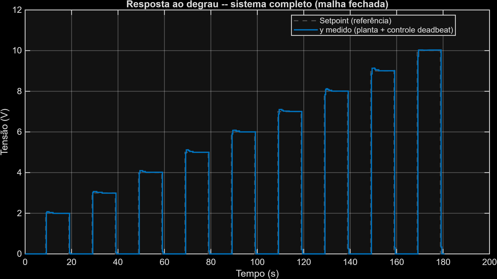
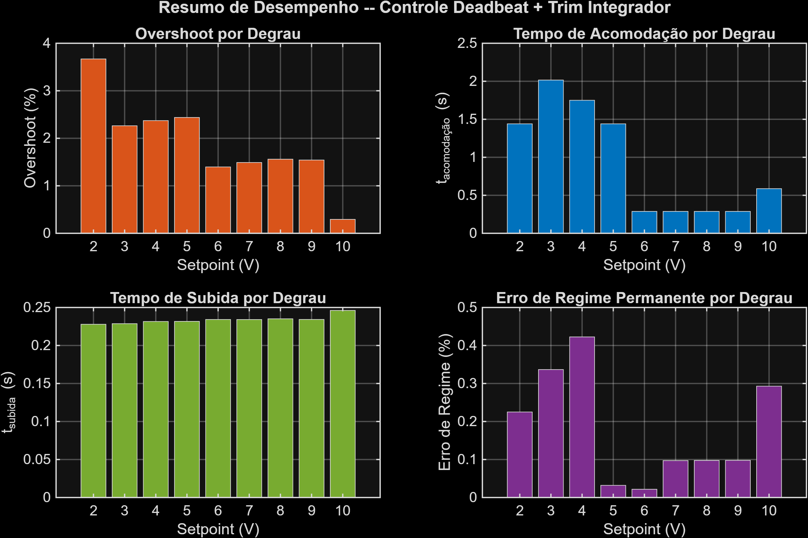
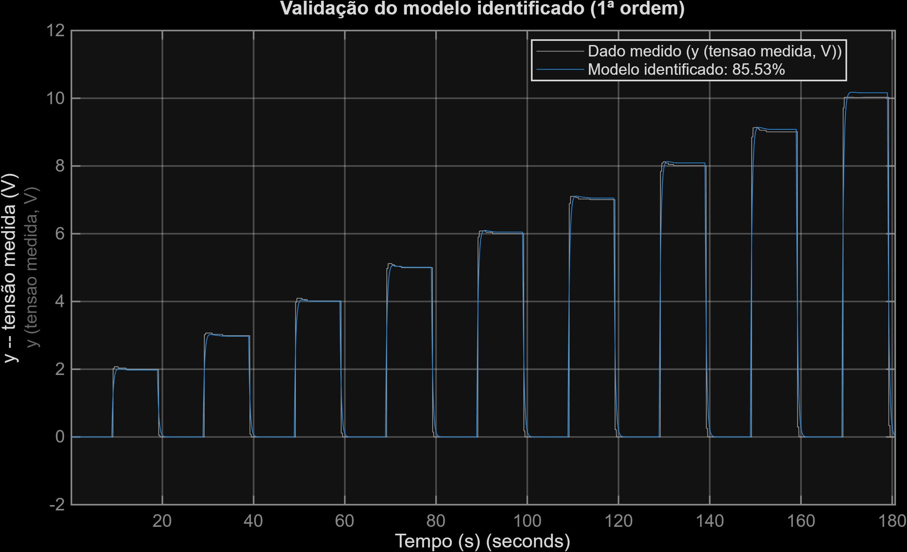
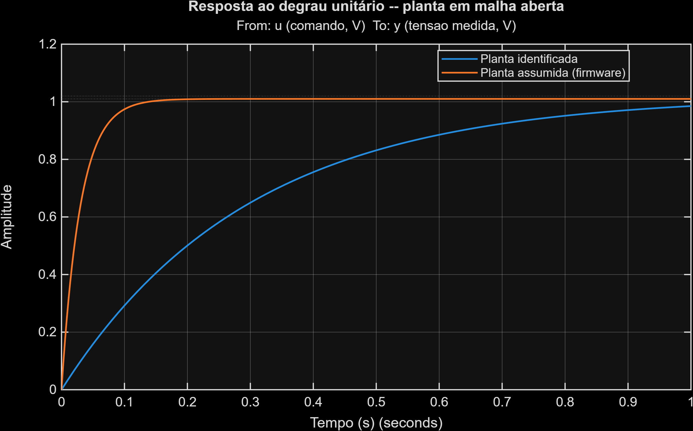
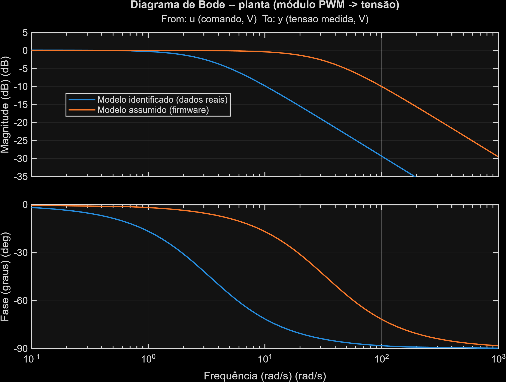
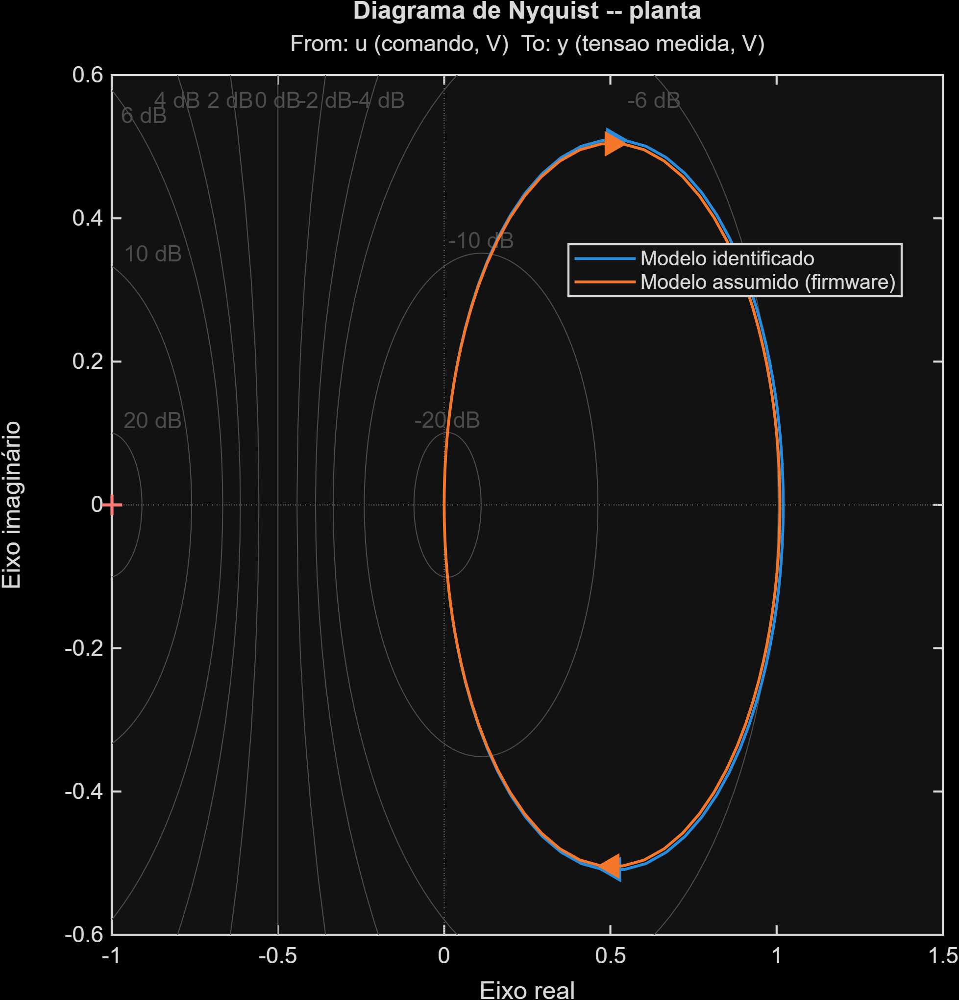

# Digital 0 to 10 V Power Supply with Deadbeat Control

Closed-loop variable voltage source (0 to 10 V) controlled by a discretized deadbeat controller running on an ESP32. Individual project, with firmware and a MATLAB analysis package.



## Overview

The goal was an adjustable 0 to 10 V analog reference, the kind used as a speed reference for frequency inverters, as a PLC analog input or on a sensor calibration bench, generated from a PWM output instead of a DAC. The ESP32 drives a PWM-to-voltage module, an external ADC reads the output back, and the controller corrects it every sampling period. Deadbeat control was chosen because it places the closed-loop pole at the origin, so the output reaches a step setpoint in one sampling period with a control law that is cheap to run on a microcontroller.

## Hardware

- ESP32-WROOM-32 on a PAT-DAELN v2.1 development board, used in a UTFPR microcontrollers course and reused for this project
- ADS1015 ADC (I2C, address 0x48) for output voltage feedback, through a 2.7 kΩ / 1.2 kΩ divider
- SSD1306 OLED display (I2C, address 0x3C)
- PWM output on GPIO18 (2 kHz, 8 bits) through the LC-LM358-PWM2V module, which converts the PWM signal into an analog voltage

## Control design

Discretized first-order plant model y[k+1] = a·y[k] + b·u[k], with a = exp(-Ts/tau) and b = K(1 - a). Deadbeat law: u[k] = (r - a·y[k]) / b, plus an integral trim term.

| Parameter | Value |
|---|---|
| K used in the control law | 1 |
| Measured plant gain | about 1.01 |
| tau | 30 ms |
| Ts | 250 ms (10 ADC samples, 25 ms apart) |
| KI_TRIM | 0.15 |
| Bias limit | +/- 2 V |
| Error dead zone | 0.02 V |
| Trim error limit | 0.5 V |

Because Ts is much longer than tau, a is close to zero and the deadbeat law reduces to u ≈ r: the deadbeat term sets the output in one step, and the trim term removes what is left.

Once the error stays within 0.025 V for 4 consecutive cycles without changing sign, the controller declares the step settled and holds the command until the next setpoint change.

- **Trim term:** every cycle it adds KI_TRIM times the error to the command, which removes the steady-state error caused by the gain mismatch (plant gain about 1.01 against K = 1). It only integrates when the error is between 0.02 V and 0.5 V, when the command is not saturated and when the error has not changed sign, and it is reset at every setpoint change.
- **Bias limit:** anti-windup clamp that keeps the accumulated trim within +/- 2 V.

## Results

Automatic test sequence 0, 1, 0, 2, 0, 3 ... 0, 10 V, 10 s per level, output measured by the ADS1015 (log recorded with the `FonteDigitalPWM_LogVerboso` firmware). The recorded log starts after the 1 V step, so the table covers the steps from 0 V to 2 through 10 V. In the log, consecutive samples are 288 ms apart, a little longer than the nominal 250 ms window, and there are no data rows between the moment each step settles and the next setpoint change.

| Setpoint (V) | Overshoot (%) | Rise time (s) | Settling time (s) | Steady-state error (%) |
|---|---|---|---|---|
| 2 | 3.67 | 0.23 | 1.44 | 0.22 |
| 3 | 2.26 | 0.23 | 2.02 | 0.34 |
| 4 | 2.37 | 0.23 | 1.75 | 0.42 |
| 5 | 2.44 | 0.23 | 1.44 | 0.03 |
| 6 | 1.40 | 0.23 | 0.29 | 0.02 |
| 7 | 1.49 | 0.23 | 0.29 | 0.10 |
| 8 | 1.56 | 0.24 | 0.29 | 0.10 |
| 9 | 1.54 | 0.23 | 0.29 | 0.10 |
| 10 | 0.29 | 0.25 | 0.59 | 0.29 |

The output reaches the new setpoint within the first sampling period. Rise time is below Ts, so it is estimated by interpolating between the two samples around each threshold. Overshoot stays under 4% and steady-state error under 0.5% on every step. A first-order model identified from the log fits the measured data at 85.5% (NRMSE).



| Model validation | Open-loop step of the plant |
|---|---|
|  |  |
| **Bode diagram** | **Nyquist diagram** |
|  |  |

Plot labels are in Portuguese.

## MATLAB analysis

The analysis package identifies the plant (first-order model), validates it against the measured data and computes the Bode and Nyquist plots, the closed-loop step response and the performance of each step. Signals are resampled with zero-order hold, because the controller holds its output constant between samples. Data are captured from the Arduino IDE serial monitor and imported into MATLAB, because opening the serial port from MATLAB toggles DTR/RTS and resets the ESP32.

## Repository structure

```
firmware/FonteDigitalPWM_Deadbeat/     final firmware, CSV log on the serial port
firmware/FonteDigitalPWM_LogVerboso/   same control, with a detailed event log
analysis/ANALISE_LOG_FONTE_DIGITAL_PWM.m   MATLAB analysis script
analysis/log_teste1.txt                recorded test log
analysis/resultados_por_degrau.csv     performance of each step
images/                                plots generated by the script
```

Code comments are in Portuguese.

## How to reproduce

**Firmware**
1. Arduino IDE with the ESP32 Arduino core 3.x (the code uses `ledcAttach`).
2. Libraries: Adafruit ADS1X15, Adafruit GFX and Adafruit SSD1306.
3. Open `firmware/FonteDigitalPWM_Deadbeat/FonteDigitalPWM_Deadbeat.ino` and upload it to the ESP32.
4. Open the Serial Monitor at 115200 baud. The board runs the 20-step sequence on its own and prints `=== SEQUENCIA AUTOMATICA CONCLUIDA ===` at the end.
5. Copy the whole output into a `.txt` file.

Serial commands: a number such as `5.0` sets the setpoint, `T=300` sets tau to 300 ms and `STATUS` prints the current parameters.

**Analysis**
1. MATLAB with the Control System Toolbox and the System Identification Toolbox.
2. Put `ANALISE_LOG_FONTE_DIGITAL_PWM.m` and the log in the same folder and set `ARQUIVO_LOG` in the script (it points to `log_teste1.txt` by default).
3. Run the script. It saves the figures as PNG and the tables as CSV.

## License

Code released under the [MIT License](LICENSE).

## Author

Felipe Martins, Mechatronics Engineering student at UTFPR, double degree at ENSTA Bretagne.
[LinkedIn](https://www.linkedin.com/in/felipe-m-k-m-martins)
